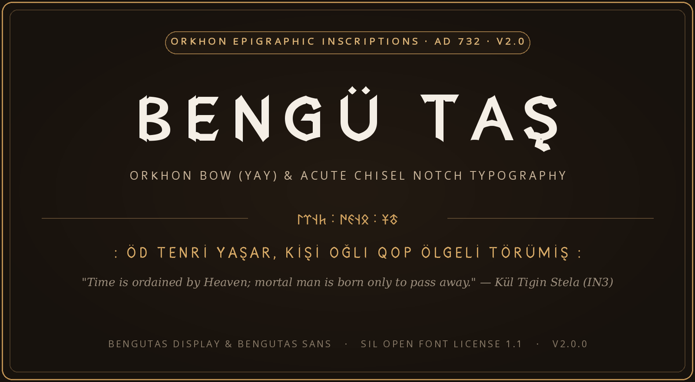

# Bengü Taş (Bengutas)

<p align="center">
  
</p>

<p align="center">
  <a href="https://opensource.org/licenses/OFL-1.1"></a>
  <a href="https://enisn.github.io/bengutas/"></a>
  <a href="#installation-and-web-integration"></a>
  <a href="#dual-family-typeface-architecture"></a>
</p>

**Bengü Taş** (*Bengutas*) is an open-source, dual-family typographic system inspired by the 8th-century epigraphic stone inscriptions of the Orkhon Valley (*Kül Tigin*, *Bilge Khagan*, and *Tonyukuk* stelae). Re-engineered in **V2.0** from paleographic analysis of the original stelae and rubbings, it unites the two signature gestures of Old Turkic stone carving—**taut composite-bow (*yay*) curves** and **razor-sharp 35°–42° acute chisel V-notches**—into a monumental modern Latin typeface.

> *Öd Teŋri yasar, kisi ogli qop ölgeli törümis.*  
> *"Time is ordained by Heaven; mortal man is born only to pass away."*  
> — **Kül Tigin Stela (AD 732)**

---

## 🏛️ Live Specimen & Interactive Type Studio

An interactive type specimen with live font switching, variable size/tracking/leading controls, Orkhon epigraphic anatomy cards, and a 157-glyph inspector is available at:  
👉 **[https://enisn.github.io/bengutas/](https://enisn.github.io/bengutas/)**

---

## 📐 Dual-Family Typeface Architecture

Bengutas is built as a complementary two-part system engineered for high-contrast display titles and sustained editorial reading:

| Family | Classification | Intended Use | Distinctive V2 Traits |
| :--- | :--- | :--- | :--- |
| **Bengutas Display** | Epigraphic Lapidary | Titles, Headers, Posters, Game UI Badges, Brand Identity | Taut composite-bow (*yay*) quadratic curves (`O, C, D, G, B, P, R, S, U`), pointed stela-arch crests, deep 35°–42° acute chisel V-notches & barbs (`E, F, H, K, L, M, N, T, Z`), diamond-chisel punctuation (`: ; .`), and automatic petite small-caps (`a–z`) with Turkish-aware `locl`. |
| **Bengutas Sans** | Lapidary Grotesque | Body Copy, UI, Editorial, Lore Descriptions | Clean grotesque proportions with 25°–30° double-chisel terminal cuts (`c, e, s, r`), sharp lapidary stem heads (`I, L, H, E, F, i, l`), broken chevron hooks (`ç, ş`), and strictly flat baselines (`y=800`). |

---

## 🏹 Orkhon Epigraphic Research & V2 Design System

### Germanic Wood-Rune Polygons vs. Orkhon Stone Epigraphy

A common pitfall in "runic" typography is treating all ancient epigraphic scripts as 100% straight polygonal lines:

1. **The Germanic Wood-Grain Constraint:** Early Germanic runes (*Elder Futhark*) were carved with a knife into wooden staves with horizontal wood grain. Carving horizontal bars or smooth curves across wood fibers splits the grain and causes adjacent cuts to flake out—forcing Germanic runes into strictly straight vertical and diagonal strokes. In Bengutas V1, forcing polygonal straight segments (`curves=False`) onto rounded letters (`O, C, D, G, B, P, R, S`) while keeping 90° orthogonal junctions on linear stems (`E, F, H, L, T`) inadvertently produced a Germanic wood-rune look rather than authentic Turkic stone epigraphy.
2. **The Orkhon Stone & *Tamga* Tradition:** The 8th-century Orkhon script (*Kül Tigin* AD 732, *Bilge Khagan* AD 735, *Tonyukuk* c. AD 716) evolved from nomadic steppe **tamgas** (clan livestock brands forged in curved iron and pecked into rock petroglyphs) and was chiseled into fine-grained marble, limestone, and granite stelae. Because stone has no wood grain, Göktürk master carvers combined **taut composite-bow (*yay*) curves** with **deep 35°–42° acute chisel V-notches**.

### Six Morphological Patterns of Bengutas Display V2

Paleographic inspection of the *Kül Tigin* and *Tonyukuk* stone rubbings and Vilhelm Thomsen's 1893 decipherment tables reveals six repeating morphological patterns that govern every glyph in **Bengutas Display V2**:

| # | Morphological Pattern | Orkhon Stela Precedents | V2 Latin Glyph Implementation |
| :--- | :--- | :--- | :--- |
| **1** | **Taut Composite-Bow (*Yay*) Loops** | `𐰖` (*y¹*), `𐰉` (*b¹*), `𐰘` (*y²*) | Curved bowls (`D, B, P, R`) spring from the vertical spine at a deep 60-UPM acute notch and arch like a drawn steppe recurve bow (*yay*) under high tension before pinching back into the stem. |
| **2** | **Pointed Stela-Arch Enclosures** | `𐱃` (*t¹*), `𐰣` (*n¹*), `𐰏` (*g²*), `𐰦` (*nt*), `𐰽` (*s¹*) | Enclosures and open arches (`O, Q, C, G, U, S, 0, 8`) use opposing quadratic bow curves meeting at a crisp pointed stela-arch crest at the crown (`y=72`) and base (`y=812`), with 38° barbed chisel hooks on open terminals. |
| **3** | **Acute 35°–42° Stem-to-Branch V-Notches** | `𐰀` (*a/e*), `𐰃` (*ı/i*), `𐰇` (*ö/ü*), `𐰰` (*op*) | Branches never meet a vertical stem at a dead 90° Latin corner. Every arm and crossbar (`E, F, H, T, Y`) undercuts the vertical pillar with a deep 50–60 UPM acute V-notch (`35°–42°`), replicating the physical V-groove where an angled iron chisel strikes the main stem channel. |
| **4** | **Upward & Downward *Tamga* Barbs** | `𐰞` (*l¹*), `𐰚` (*k²*), `𐰔` (*z*), `𐰡` (*lt*), `𐰴` (*q*) | Linear letters incorporate authentic Orkhon *tamga* signatures: the upward-kicking foot barb of `L` (`𐰞`), the acute upper slash + taut bowed kick-leg of `K` (`𐰚`), the pointed stela crowns and deep inner V-crotches of `M, N` (`𐰡, 𐰇`), and the double-barbed forward slash of `Z` (`𐰔`). |
| **5** | **Diamond-Chisel Word Dividers** | `⁚` (Orkhon word separator) | Orkhon inscriptions separate words using twin vertical diamond-shaped chisel strikes (`⁚`). All punctuation dots (`. , : ; ! ? … · •`) and Turkish diacritic dots (`İ, Ö, Ü, i.loclTRK, ö, ü`) are sculpted as 45° diamond chisel strikes. |
| **6** | **Petite Small-Caps & Turkish `locl`** | Monumental majuscule cadence | Lowercase `a–z` renders as `82%` height petite majuscules (`y=215..800`) with full *yay* bow curves and acute notches. Default `i` is dotless (`Village` → `VILLAGE`), while OpenType `locl` restores the diamond-dotted `i.loclTRK` for Turkic languages (`Bilge` → `BİLGE`). |

---

## 🗿 Historical Context & Etymology of "Bengü Taş"

In Old Turkic, the phrase is inscribed in the Orkhon script as **𐰋𐰭𐰇 𐱃𐱁** (*beŋü taş* or *meŋgü taş*):
* **Bengü / Meŋü:** *Eternal, everlasting, immortal, perpetual.*
* **Taş:** *Stone, rock, monument.*
* **Literal Translation:** **"The Eternal Stone"** or **"Monument of Eternity."**

### Eighth-Century Orkhon Monuments
During the Second Turkic Khaganate (c. AD 720–735), the Göktürks erected monumental stelae in the Orkhon Valley of modern-day Mongolia to commemorate **Bilge Khagan**, prince **Kül Tigin**, and grand counsellor **Tonyukuk**. In the inscriptions, the rulers explicitly called these monuments **Bengü Taş**:
> *« ...men bökelerig bengü taş toqıtdım... »*  
> *"I had an eternal stone carved so that the memory would not perish."*

Released under the **SIL Open Font License 1.1**, Bengutas carries that 1,300-year-old epigraphic tradition into an open digital artifact for historical strategy games, literature, cultural institutions, and display typography.

---

## 📂 Repository Structure

```
bengutas/
├── bengutas.pen          # Single Source of Truth: V2 Display & Sans master glyph vectors
├── build.sh              # One-step compiler, packager, and local installer
├── dist/                 # Ready-to-use production binaries
│   ├── ttf/              # TrueType format (.ttf) — Display, Display TR, Sans (Regular & Bold)
│   ├── otf/              # OpenType format (.otf)
│   └── web/              # Web formats (.woff, .woff2)
├── docs/                 # Interactive specimen hosted via GitHub Pages
│   ├── banner.png        # V2 typographic hero banner
│   ├── bengutas-fonts.zip# Complete downloadable font bundle
│   └── index.html        # Live web studio, Orkhon research showcase & 157-glyph inspector
├── src/                  # FontForge Python compilation pipeline
│   └── build.py          # Parses bengutas.pen, builds Regular/Bold & OpenType locl tables
├── CHANGELOG.md          # Release history
├── LICENSE               # SIL Open Font License 1.1
└── README.md
```

---

## 📦 Installation and Web Integration

### Downloads
Each release is published on [GitHub Releases](https://github.com/enisn/bengutas/releases/latest) with a `bengutas-fonts-<version>.zip` bundle (TTF, OTF, WOFF, WOFF2) and individual TTF files. Version history is documented in [`CHANGELOG.md`](CHANGELOG.md).

### Desktop (macOS, Windows, Linux)
Download the `.ttf` or `.otf` files from the latest release (or directly from `dist/ttf/` or `dist/otf/`) and install them via your operating system's font manager.

### Web (`@font-face` CSS)
```css
@font-face {
  font-family: 'Bengutas Display';
  src: url('dist/web/BengutasDisplay-Regular.woff2') format('woff2');
  font-weight: 400;
  font-style: normal;
}

@font-face {
  font-family: 'Bengutas Sans';
  src: url('dist/web/BengutasSans-Regular.woff2') format('woff2');
  font-weight: 400;
  font-style: normal;
}

h1, h2, .headline {
  font-family: 'Bengutas Display', serif;
  letter-spacing: 1.5px;
}

body, p {
  font-family: 'Bengutas Sans', sans-serif;
}
```

### Turkish Small-Cap `i` in Bengutas Display
`Bengutas Display` renders lowercase as petite small-caps, and a small capital `I` carries no dot in Latin typography. The default `i` is therefore dotless; the diamond-dotted form lives in the glyph `i.loclTRK` and is automatically selected by the OpenType `locl` feature when text is tagged with a Turkic language (`TRK`, `AZE`, `CRT`, `KAZ`, `TAT`):

```html
<h1 lang="en">Village</h1>     <!-- VILLAGE -->
<h1 lang="tr">Bilge Kağan</h1> <!-- BİLGE KAĞAN -->
```

Browsers, Word, InDesign, and Affinity honor the `lang` attribute automatically. For engines that do not process OpenType `locl` (such as Unity TextMeshPro), use the **Bengutas Display TR** build (`BengutasDisplayTR-*.ttf`), which sets the dotted petite-cap `i` as the default glyph for Turkish locales.

---

## 🛠️ Building Fonts from Source (`bengutas.pen`)

`bengutas.pen` is the **Single Source of Truth** for all 157 vector glyphs in both typeface families.

### Visual Glyph Matrices (`pen.dev` / Pencil)
The design file contains two master glyph tables:
1. **`Bengutas Display`**: V2 Orkhon composite-bow (*yay*) and acute chisel-notch master glyphs (`A–Z`, `a–z` petite small-caps, 18 Turkish diacritics, numerals `0–9`, and 77 epigraphic symbols).
2. **`Bengutas Sans`**: Lapidary grotesque master glyphs with double-chisel terminals and grounded flat baselines.

### Compiling Production Binaries
To compile all 6 font binaries (`Display Regular/Bold`, `Display TR Regular/Bold`, `Sans Regular/Bold`) in `.ttf`, `.otf`, `.woff`, and `.woff2` formats directly from `bengutas.pen`:

```bash
# Requires FontForge (sudo apt install fontforge)
./build.sh
```

The build pipeline (`src/build.py`):
1. Extracts all SVG outlines and advance widths directly from `bengutas.pen`.
2. Normalizes contour directions, resolves overlaps, and procedurally expands Bold weights (`+32 UPM`) with degenerate-contour filtering so acute V-notches remain razor-sharp.
3. Compiles OpenType `locl` tables for Turkic small-cap `i` support.
4. Updates `dist/`, `docs/`, and packages `docs/bengutas-fonts.zip`.

---

## 📜 License

This font software is licensed under the **SIL Open Font License, Version 1.1 (OFL 1.1)**.  
Reserved Font Names: `Bengü Taş`, `Bengutas`.

* **Permitted:** Free to use in commercial and personal projects, applications, websites, games, printed publications, and brand identities without royalties.
* **Prohibited:** Neither the font software nor any of its components may be sold by itself, or repackaged and sold under a different name.

---

**Bengü Taş (Bengutas)** — Epigraphic Lapidary Typeface Project.
